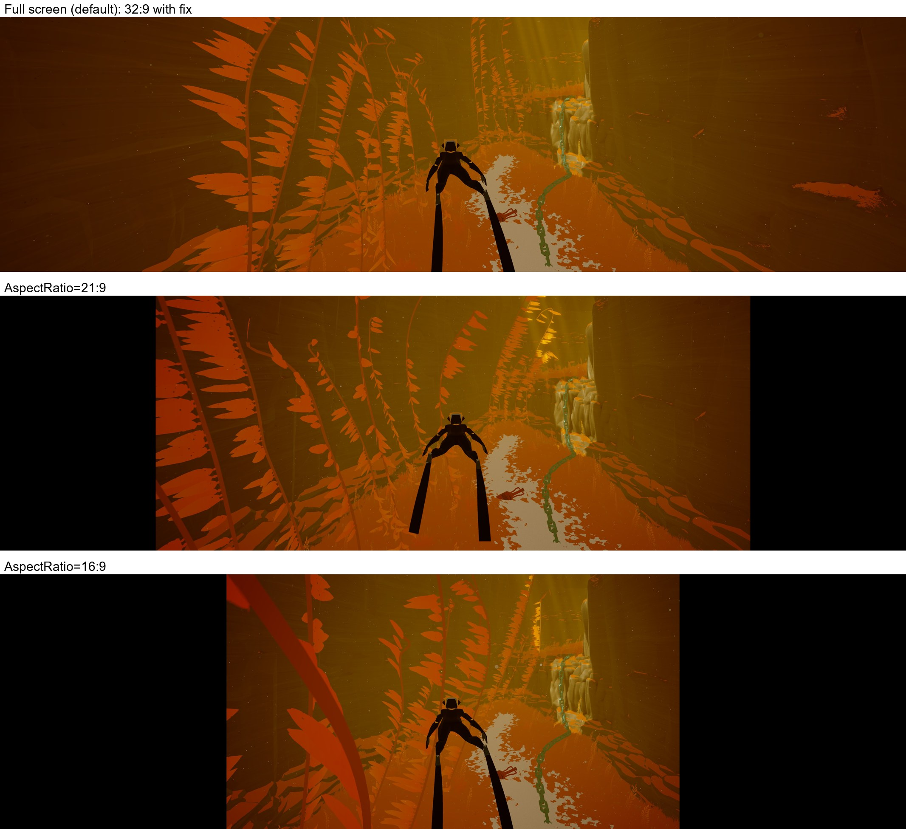

# Abzu Screen Resolution Fix

A resolution-only fix that makes ABZÛ (PC, Steam) display correctly on ultrawide (21:9) and
super-ultrawide (32:9) monitors. Nothing else about the game is changed: no game files are edited,
and at 16:9 or narrower the game behaves exactly as before.


## Install
1. Copy `bin\version.dll` and `bin\AbzuFix.ini` into
   `<Steam library>\steamapps\common\ABZU\AbzuGame\Binaries\Win64\`
   (next to `AbzuGame-Win64-Shipping.exe`).
2. Make the game run at your monitor's native resolution. The game often falls back to 1920x1080,
   so set it in `%LOCALAPPDATA%\AbzuGame\Saved\Config\WindowsNoEditor\GameUserSettings.ini`
   (see `config\GameUserSettings.5120x1440.ini`): `ResolutionSizeX/Y`, `DesiredScreenWidth/Height`
   and `LastUserConfirmedResolutionSizeX/Y`.

**Uninstall:** delete `version.dll` and `AbzuFix.ini` from that folder. `Enabled=0` in the ini
also turns the fix off.

## Black-bar mode (optional)
Set `AspectRatio` in `AbzuFix.ini` to play in a narrower shape, centred, with black bars at the
sides, while the game stays fullscreen at native resolution. The monitor doesn't switch modes, so
the picture stays sharp and alt-tab stays fast. The view is exactly what a real monitor of that
shape would show.

```ini
AspectRatio=0      ; default: fill the whole screen
AspectRatio=21:9   ; also 64:27, 16:9, or a decimal such as 2.37
```



Menus and on-screen text are laid out for the full screen width, so menus stay centred.

## What was wrong
- UE 4.12.5, Steam app 384190. The engine uses its default "keep horizontal FOV" projection.
- ABZU's camera code (`exe+0x161A00`) does proper Hor+: it takes a vertical FOV (58° in normal
  play) and sets the horizontal FOV to `2·atan(tan(58°/2)·aspect)`: 72.9° at 4:3, 89.2° at 16:9.
- It then clamps that to **100°**. Past about 19.4:9 the clamp kicks in, the horizontal FOV stops
  growing, and the engine crops the top and bottom instead. At 32:9 the picture was zoomed in
  1.7x vertically (diver's fins cut off).

## What the fix does
`version.dll` passes every call through to the system `version.dll` and hooks that one camera
function. When the screen is wider than 16:9, it replaces the fixed 100° cap with the same cap
converted from 16:9 to the current aspect ratio:

- normal play keeps the 16:9 vertical view: 104.6° at 21:9, 126.2° at 32:9;
- any shot the game capped at 100° on 16:9 stays capped at the same vertical view;
- 16:9 and narrower: the function's result is not touched.

The hook finds the function by byte pattern and checks the cap instruction. If the game version
differs, it does nothing.

## Verified
| Aspect | Game FOV | With fix | Result |
|---|---|---|---|
| 4:3 (1920x1440) | 72.9° | unchanged | reference (same vertical as 16:9) |
| 16:9 (2560x1440) | 89.2° | unchanged | reference |
| 21:9 (2520x1080) | 100° (capped) | 104.6° | from the log only (no screenshot) |
| 32:9 (5120x1440) | 100° (capped) | 126.2° | screenshots: same framing as 16:9 (measured zoom 1.03 vs 1.70 before) |

Black-bar mode on 5120x1440: `21:9` gives a centred 3360x1440 picture, `16:9` gives 2560x1440
(menu and gameplay checked).

Not yet checked in game: story cutscenes.

## Build
Run `build.cmd` (needs Visual Studio with "Desktop development with C++"). Output: `bin\version.dll`.
`tools\run_at.ps1` launches the game at a given resolution for testing.

## Files
- `src\` - the DLL source (`AbzuFix.cpp` hook, `proxy_version.cpp` + `version.def` pass-through).
- `config\` - working 5120x1440 settings file.
- `backup\` - the original game settings files and save, from before any testing.
- `screenshots\` - baseline (4:3 / 16:9 / 32:9) and fixed captures.
