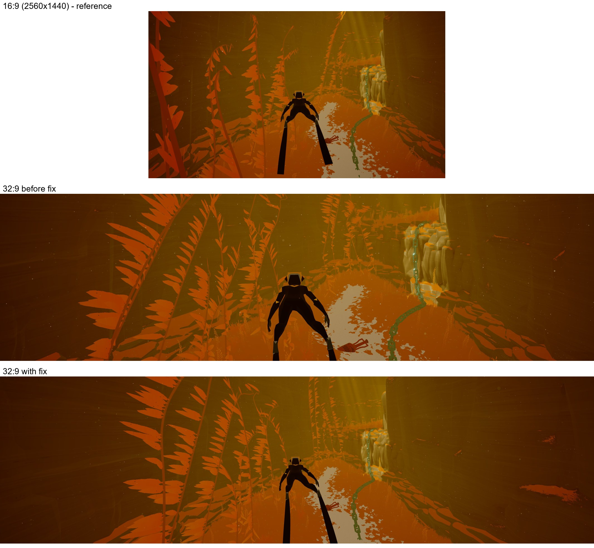
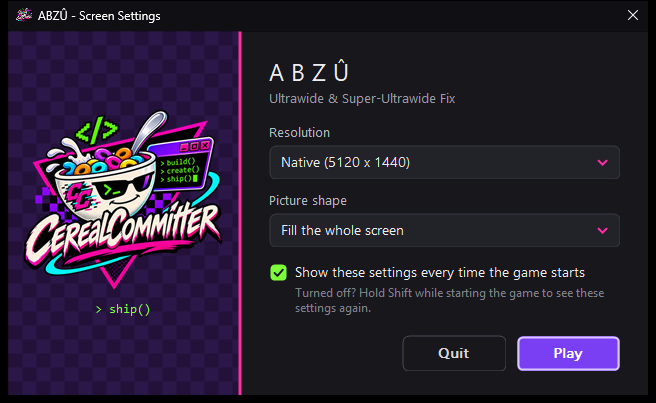

# Abzu Ultrawide & Super-Ultrawide Fix

A fix that makes ABZÛ (PC) display correctly on ultrawide (21:9) and
super-ultrawide (32:9) monitors. Nothing else about the game is changed: no game files are edited,
and at 16:9 or narrower the game behaves exactly as before.



## Install
Copy `bin\version.dll` and `bin\AbzuFix.ini` into the game's `AbzuGame\Binaries\Win64\` folder,
next to `AbzuGame-Win64-Shipping.exe`. For Steam that is
`<Steam library>\steamapps\common\ABZU\AbzuGame\Binaries\Win64\`.

That's all: no launch options or settings files to edit.

**Uninstall:** delete `version.dll` and `AbzuFix.ini` from that folder.

### Other stores
ABZU is also sold on the Epic Games Store and DRM-free on GOG (and was on Origin). They're the same
Unreal Engine game, so the install is the same: drop the two files next to the game's exe. The
settings window and resolution handling work regardless of store. The FOV fix finds its hook by byte
pattern; if another store's build differs, it switches itself off rather than misbehaving. Only the
Steam version has been tested.

## Settings window
A small window opens when the game starts, before the game itself loads, however it's launched
(Steam, another store's launcher, or the exe directly):



- **Resolution**: "Native" (your monitor's resolution) or any mode your monitor supports.
- **Picture shape**: fill the whole screen, or 21:9 / 16:9 / 4:3 with black bars at the sides.
- **Show these settings every time the game starts**: untick to skip the window and start straight
  away with your saved settings. Hold **Shift** while starting the game to see the window again.
- **Play** starts the game with those settings; **Quit** cancels the launch.

The chosen resolution is written into the game's own settings at every launch, even when the
window is hidden. ABZU's in-game "Native" display setting resolves to the wrong size on some
monitors (3840x1080 on a 5120x1440 screen), and changing in-game options can reset the resolution
to that "Native"; the next launch puts it back.

## Black-bar mode
Choosing a narrower picture shape plays the game in that shape, centred, with black bars at the
sides, while it stays fullscreen at your resolution. The monitor doesn't switch modes, so the
picture stays sharp and alt-tab stays fast. The view is exactly what a real monitor of that shape
would show. The setting is stored in `AbzuFix.ini` and can also be set there:

```ini
AspectRatio=0      ; fill the whole screen
AspectRatio=21:9   ; also 64:27, 16:9, or a decimal such as 2.37
```


Menus and on-screen text are laid out for the full screen width, so menus stay centred.

## What was wrong
- UE 4.12.5, Steam app 384190. The engine uses its default "keep horizontal FOV" projection.
- ABZU's camera code (`exe+0x161A00`) does proper Hor+: it takes a vertical FOV (58° in normal
  play) and sets the horizontal FOV to `2·atan(tan(58°/2)·aspect)`: 72.9° at 4:3, 89.2° at 16:9.
- It then clamps that to **100°**. Past about 19.4:9 the clamp kicks in, the horizontal FOV stops
  growing, and the engine crops the top and bottom instead. At 32:9 the picture was zoomed in
  1.7x vertically (diver's fins cut off).

## What the fix does
`version.dll` passes every call through to the system `version.dll` and hooks that one camera
function. When the screen is wider than 16:9, it replaces the fixed 100° cap with the same cap
converted from 16:9 to the current aspect ratio:

- normal play keeps the 16:9 vertical view: 104.6° at 21:9, 126.2° at 32:9;
- any shot the game capped at 100° on 16:9 stays capped at the same vertical view;
- 16:9 and narrower: the function's result is not touched.

The hook finds the function by byte pattern and checks the cap instruction. If the game version
differs, it does nothing.

### Startup fixes
- **Boot resolution.** Unreal replaces a fullscreen resolution that isn't smaller than the
  monitor's "native" size with that native size, and reads "native" from the monitor's EDID. Some
  monitors report less than they support (this 5120x1440 monitor reports 3840x1080), so the game
  booted at 3840x1080, played its intro there, and switched to 5120x1440 afterwards. The second
  display-mode switch blacked out the Giant Squid logo. The DLL hooks
  `UGameEngine::DetermineGameWindowResolution` (`exe+0x10EBA40`) so fullscreen boots straight
  into the chosen resolution (native = the desktop's resolution). This is also why the in-game
  "Display Res: Native" picks 3840x1080.
- **Starting minimized.** Steam starts the game through `AbzuGame.exe`, so Windows refuses the real
  game's request for focus, and a fullscreen Unreal window without focus minimizes itself. During
  startup only, the DLL catches the game's own `ShowWindow` / `SetForegroundWindow` calls: it
  retries the focus request and keeps the window from minimizing. After the game has had focus,
  both calls are untouched, so alt-tab works as normal.

## Verified
| Aspect | Game FOV | With fix | Result |
|---|---|---|---|
| 4:3 (1920x1440) | 72.9° | unchanged | reference (same vertical as 16:9) |
| 16:9 (2560x1440) | 89.2° | unchanged | reference |
| 21:9 (2520x1080) | 100° (capped) | 104.6° | from the log only (no screenshot) |
| 32:9 (5120x1440) | 100° (capped) | 126.2° | screenshots: same framing as 16:9 (measured zoom 1.03 vs 1.70 before) |

Black-bar mode on 5120x1440: `21:9` gives a centred 3360x1440 picture, `16:9` gives 2560x1440
(menu and gameplay checked).

Settings window (Steam launch): opens before the game; Play with "Native" took the game from its
own 3840x1080 pick to 5120x1440; choosing 21:9 gave black bars; with the window turned off the
resolution is still corrected. Holding Shift reopens it (play-tested).

Startup (launched from Steam's Play button, both with and without the settings window): the game
window opens directly at 5120x1440 fullscreen with focus, and the Giant Squid and 505 Games logos
both show.

Story cutscenes are rendered in-engine and go through the same camera code; play-tested on 32:9
and they display correctly.

## Build
Run `build.cmd` (needs Visual Studio with "Desktop development with C++"). Output: `bin\version.dll`.
`tools\run_at.ps1` launches the game at a given resolution for testing.

## Files
- `src\` - the DLL source: `AbzuFix.cpp` (hooks), `Settings.cpp` (ABZU's settings),
  `LauncherUI.cpp` (reusable CerealCommitter launcher window), `proxy_version.cpp` + `version.def`
  (pass-through to the system `version.dll`), `resources.rc` (embedded logo).
- `assets\` - the logo embedded in the DLL.
- `design\` - launcher design mockups.
- `config\` - working 5120x1440 settings file.
- `screenshots\` - baseline (4:3 / 16:9 / 32:9) and fixed captures.
